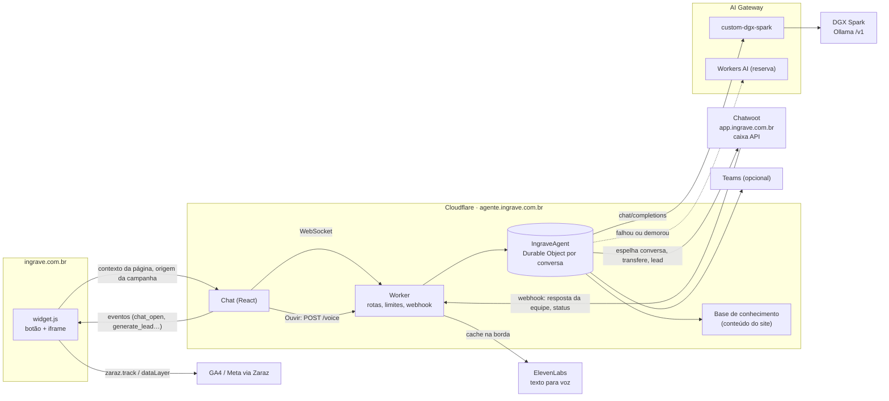

# Assistente de IA do site Ingrave

Este é o agente de IA que atende os visitantes de **ingrave.com.br**, com uma experiência parecida com a do assistente do site da Cloudflare:
- abre num botão flutuante;
- responde na hora com base no conteúdo oficial do site;
- calcula o custo do WhatsApp e mostra a agenda de demonstração;
- lê as respostas em voz alta com a **ElevenLabs** (botão "Ouvir");
- passa a conversa para a equipe no **Chatwoot (app.ingrave.com.br)** quando a pessoa pede.

Ele foi construído sobre o [Cloudflare Agents Starter](https://github.com/cloudflare/agents-starter), com estas peças:
- **Cloudflare Agents SDK:** Worker + Durable Object `IngraveAgent`, uma instância por conversa, com o histórico guardado no SQLite do próprio objeto.
- **Modelo principal:** o **DGX Spark** (Ollama, API compatível com OpenAI), acessado pelo **AI Gateway** como *custom provider*.
- **Modelo reserva:** o **Workers AI**, chamado pelo mesmo gateway quando o DGX está fora do ar ou demora a responder.
- **Chatwoot:** uma caixa do tipo **API** dedicada ao assistente. As conversas da IA ficam espelhadas como *pendentes* e a transferência abre a conversa para a equipe. As respostas da equipe voltam para o chat do site em tempo real.



## O que o assistente faz

| Ferramenta | Quando | Confirmação do visitante |
|---|---|---|
| `buscar_conhecimento` | Dúvidas sobre recursos, canais, integrações, planos e comparativos. AI Search (híbrida + reranking), com a busca local BM25 de reserva; mostra as fontes. | não |
| `calcular_custo_whatsapp` | Estimativa do custo da Meta por template, com a assinatura da Ingrave se a pessoa informar. | não |
| `agendar_demonstracao` | Mostra o botão da agenda (Microsoft Bookings). | não |
| `registrar_contato` | A pessoa quer ser contatada: nome, e-mail, telefone, empresa e interesse vão para o contato no Chatwoot, com etiqueta `lead-agente` e alerta no Teams. | **sim** |
| `transferir_para_humano` | Pedido de atendimento humano, suporte de conta, negociação ou algo fora do alcance da IA. | **sim** |

### Modos da conversa

| Modo | Como funciona |
|---|---|
| **ai** | A IA responde. Ao fim de cada resposta, a pergunta e a resposta vão para uma conversa **pendente** no Chatwoot, com a etiqueta `agente-ia`. Pendentes não entram na fila, mas a equipe pode revisar. |
| **waiting** | Depois da transferência: a conversa é **aberta** no Chatwoot, com nota de resumo, etiquetas `transferido` e o motivo, time atribuído e alerta no Teams. O visitante vê um aviso de fila, que menciona quando está fora do horário. |
| **human** | Quando alguém da equipe responde no Chatwoot, a resposta aparece no chat do site com nome e foto, e a IA fica em silêncio. Isso vale mesmo sem transferência, então a equipe pode entrar a qualquer momento. "Digitando…" também aparece. |
| volta para **ai** | Quando a conversa é **resolvida**, ou volta para **pendente**, no Chatwoot. |

### Contexto e métricas

O `widget.js` envia ao chat:
- a página atual;
- o título da página;
- a primeira e a última origem da visita que o site já guarda (`ig_first_touch` e `ig_last_touch`: UTMs, gclid, fbclid, referrer).

Esses dados aparecem no prompt e nos atributos do contato no Chatwoot (`origem_campanha`, `pagina_entrada`).

Os eventos `chat_open`, `agent_chat_start`, `generate_lead` (`form=agente`), `agent_handoff`, `booking_click` e `sign_up_click` são enviados para `zaraz.track` na página do site. Assim eles respeitam o consentimento de cookies do Zaraz, e o Lead do Pixel e o `generate_lead` do GA4 já funcionam sem configuração nova.

### Voz (ElevenLabs)

Com o secret `ELEVENLABS_API_KEY`, cada resposta ganha o botão **Ouvir**. O botão chama `POST /voice`, que:
- limpa o markdown e os links;
- gera o MP3 na ElevenLabs, com o modelo `eleven_multilingual_v2` e a voz `ELEVENLABS_VOICE_ID`, os mesmos da integração antiga;
- guarda o áudio no cache da borda por 7 dias, então a mesma resposta não é cobrada duas vezes.

A chamada vai direto para a ElevenLabs, sem o gateway, porque o plano gratuito deles recusa proxies. A rota exige id de conversa válido e origem permitida, tem limite por IP e aceita no máximo 1.500 caracteres. Sem a chave, o botão não aparece.

### Falar com o assistente (microfone)

O botão de **microfone** no campo de mensagem grava até 60 s. O áudio vai para `POST /transcribe`, que o transcreve com o **Workers AI Whisper** (`@cf/openai/whisper-large-v3-turbo`, em português, com o vocabulário da Ingrave como dica), passando pelo mesmo AI Gateway.

O texto transcrito é enviado como mensagem do visitante. Quando a pergunta veio por voz, a resposta é **lida em voz alta automaticamente** pela ElevenLabs, então a conversa fica toda falada.

A rota exige id de conversa e origem válidos, só aceita `audio/*`, tem limite por IP e aceita no máximo 2 MB. O iframe do `widget.js` já pede a permissão de microfone. Se o navegador não suportar gravação, o botão não aparece.

### Busca no site (AI Search)

A ferramenta `buscar_conhecimento` consulta primeiro a instância do **Cloudflare AI Search**
definida em `AI_SEARCH_INSTANCE` (`assistente-ingrave`, namespace `default`): busca híbrida
(vetorial + palavras-chave) com reranking sobre o site rastreado, sempre atualizado. Se a
instância não existir, falhar, demorar mais de 5 s ou não achar nada relevante, a busca local
(BM25 sobre `src/knowledge/site.json`) responde. O `/health` mostra qual busca está ativa.

### Avaliação das respostas (👍/👎)

Cada resposta do assistente tem 👍/👎. A avaliação vai para os logs do **AI Gateway**
(campo *feedback*, visível em Logs e em User Insights) e, quando negativa, o Chatwoot recebe
uma nota privada com o trecho da resposta e a etiqueta `ia-resposta-ruim`. Toda chamada ao
DGX leva metadados no gateway (`session`, `page`, `origin`) para filtrar os logs por conversa.

### Proteções
- O id da conversa é um UUID aleatório criado no navegador. Sem ele não há acesso ao histórico.
- O WebSocket só aceita a origem do próprio assistente e do site (`SITE_ORIGINS`).
- O chat só pode ser exibido em iframe pelo site, por causa do `frame-ancestors` em `public/_headers`.
- Há um limite por IP (`RATE_LIMITER`), outro de 60 mensagens por conversa e outro de 4.000 caracteres por mensagem.
- O estado da conversa (modo, lead) só muda pelo servidor.
- O webhook do Chatwoot exige `?secret=` com comparação em tempo constante. Notas privadas e o eco das mensagens da própria IA são ignorados.
- O contexto vindo do navegador é filtrado: só os campos conhecidos passam, com tamanho limitado.

## Configuração

### 1. AI Gateway + DGX Spark

1. Em **AI → AI Gateway**, use o gateway `default` (criado automaticamente) ou crie um próprio e ajuste `AI_GATEWAY_ID`.
2. Ligue **Authenticated Gateway** e gere um token. Ele vira o secret `AI_GATEWAY_TOKEN`.
3. Em **Custom Providers**, crie o provedor:
   - **slug:** `dgx-spark`;
   - **base_url:** a URL HTTPS do DGX, **sem** `/v1`. Por exemplo, o worker `ingrave-ollama-proxy` ou o túnel que expõe o Ollama.

   As chamadas saem para `https://gateway.ai.cloudflare.com/v1/{conta}/default/custom-dgx-spark/v1/chat/completions`.
4. Se o DGX exigir chave, guarde-a no gateway (BYOK) ou no secret `DGX_API_KEY`.
5. Em `wrangler.jsonc`, confira `AI_GATEWAY_ACCOUNT_ID` (já preenchido com a conta da Ingrave) e `DGX_MODEL`, que hoje é **`gemma4:12b`**: testado com tool calling no DGX. O modelo precisa suportar *tool calling*. Alternativas no DGX: `qwen3:32b`, `gpt-oss:120b`.

Configuração atual: gateway `default`, custom provider `dgx-spark` com base_url `https://llm.ingrave.com.br`.

Enquanto o custom provider não existir, a chamada ao DGX falha na hora e o assistente responde com o Workers AI (`FALLBACK_MODEL`). Por isso o primeiro deploy já funciona. Com `AI_GATEWAY_ACCOUNT_ID` vazio, ele usa só o Workers AI.

> **Segurança do DGX:** hoje o `ingrave-ollama-proxy` aceita chamadas sem autenticação. Proteja o endpoint antes de colocá-lo no gateway: Cloudflare Access com *service token* ou uma chave verificada no proxy.

### 2. Chatwoot (app.ingrave.com.br)

1. Em **Configurações → Caixas de entrada → Adicionar**, escolha **API** e dê o nome "Assistente do site".
2. Em **Webhook URL**, use `https://agente.ingrave.com.br/chatwoot/webhook?secret=<um segredo longo>`.
3. Adicione à caixa os agentes que vão atender e um usuário de serviço. O token desse usuário é o `CHATWOOT_API_TOKEN`.
4. Anote o **id da caixa** (na URL de configurações) e o **id da conta**. Opcionalmente, anote também o id do time de vendas (`CHATWOOT_HANDOFF_TEAM_ID`).
5. Crie as etiquetas `agente-ia`, `transferido`, `lead-agente`, `vendas`, `suporte`, `financeiro` e `outro`. Se elas não existirem, o Chatwoot ignora.

### 3. Variáveis e secrets

Em `wrangler.jsonc` → `vars`, preencha:
- `AI_GATEWAY_ACCOUNT_ID`;
- `CHATWOOT_ACCOUNT_ID` e `CHATWOOT_INBOX_ID`;
- opcionalmente `CHATWOOT_HANDOFF_TEAM_ID`;
- `BUSINESS_HOURS`, no formato `1-5 09:00-18:00`, em que os dias vão de 0 (domingo) a 6;
- `BOOKINGS_URL` e `SITE_ORIGINS`.

Depois grave os secrets:

```bash
npx wrangler secret put AI_GATEWAY_TOKEN
npx wrangler secret put CHATWOOT_API_TOKEN
npx wrangler secret put CHATWOOT_WEBHOOK_SECRET   # o mesmo do ?secret= do webhook
npx wrangler secret put TEAMS_WEBHOOK_URL         # opcional, o mesmo do formulário do site
npx wrangler secret put DGX_API_KEY               # opcional
npx wrangler secret put ELEVENLABS_API_KEY        # opcional, liga o botão "Ouvir"
```

### 4. Deploy

```bash
npm install
npm run deploy
```

O repositório já tem o **Workers Builds** ligado ao worker antigo `my-chat-agent`. Como este projeto publica outro worker, esse build falha por diferença de nome. Para publicar automaticamente a cada merge:
1. Em **Workers & Pages → Create → Import a repository**, escolha `ingrave-solucoes/my-chat-agent`.
2. Dê ao worker o nome `ingrave-site-agent`, com build `npm run build` e deploy `npx wrangler deploy`.
3. No worker antigo `my-chat-agent`, desconecte o repositório em **Settings → Builds**. Se ele não estiver mais em uso, pode apagá-lo.

O worker se chama `ingrave-site-agent` e responde em `agente.ingrave.com.br`, porque o domínio próprio é criado no deploy. `GET /health` mostra o modelo ativo e se o Chatwoot e a voz estão configurados.

### 5. Colocar no site

Em **Zaraz → Tools → Add new tool → Custom HTML**, crie a ferramenta sem finalidade de consentimento, porque o chat é funcional, e use:

```html
<script src="https://agente.ingrave.com.br/widget.js" defer></script>
```

Depois remova o botão de chat antigo do Chatwoot do Zaraz, para não ficarem dois botões. Para abrir o chat a partir de qualquer link do site, use `href="#assistente"`, `data-ingrave-agent` ou `window.IngraveAgent.open()`.

Opções do script:
- `data-label`: texto do botão;
- `data-greeting`: balão de boas-vindas depois de 12 s; vazio desliga;
- `data-position="left"`.

## Manutenção

- **Base de conhecimento:** quando planos, recursos ou guias mudarem no site, rode o comando abaixo e faça o deploy.

  ```bash
  npm run sync-knowledge -- ../ingrave-site
  ```

  Ele recria `src/knowledge/site.json` a partir de `client/src/content` do repositório do site.
- **Prompt:** `src/prompt.ts`. Os preços entram da base de conhecimento, nunca escritos à mão.
- **Testes:** `npm test`.
- **Desenvolvimento local sem login na Cloudflare:**

  ```bash
  node scripts/local-config.mjs
  cp .dev.vars.example .dev.vars   # DGX_BASE_URL=http://localhost:11434/v1 aponta direto para um Ollama
  WRANGLER_CONFIG=wrangler.local.jsonc npx vite dev
  ```

## Estrutura

```
src/
  server.ts        Worker: /agents/*, /chatwoot/webhook, /health, limites e origem
  agent.ts         IngraveAgent (Durable Object): turnos, espelhamento, transferência, webhook
  model.ts         DGX Spark via AI Gateway + reserva Workers AI
  prompt.ts        prompt do sistema
  tools.ts         ferramentas do agente
  chatwoot.ts      API de aplicação do Chatwoot e regras do webhook
  hours.ts         horário de atendimento
  voice.ts         ElevenLabs (texto para voz) com cache
  transcribe.ts    Workers AI Whisper (voz para texto)
  knowledge/       base de conhecimento (site.json) e busca
  app.tsx          interface do chat (iframe)
public/
  widget.js        botão e painel para o site
  _headers         frame-ancestors e cache
scripts/
  sync-knowledge.mjs, local-config.mjs
tests/core.test.ts
container/fragrant-art-eff1   Worker independente (container), inalterado
```
